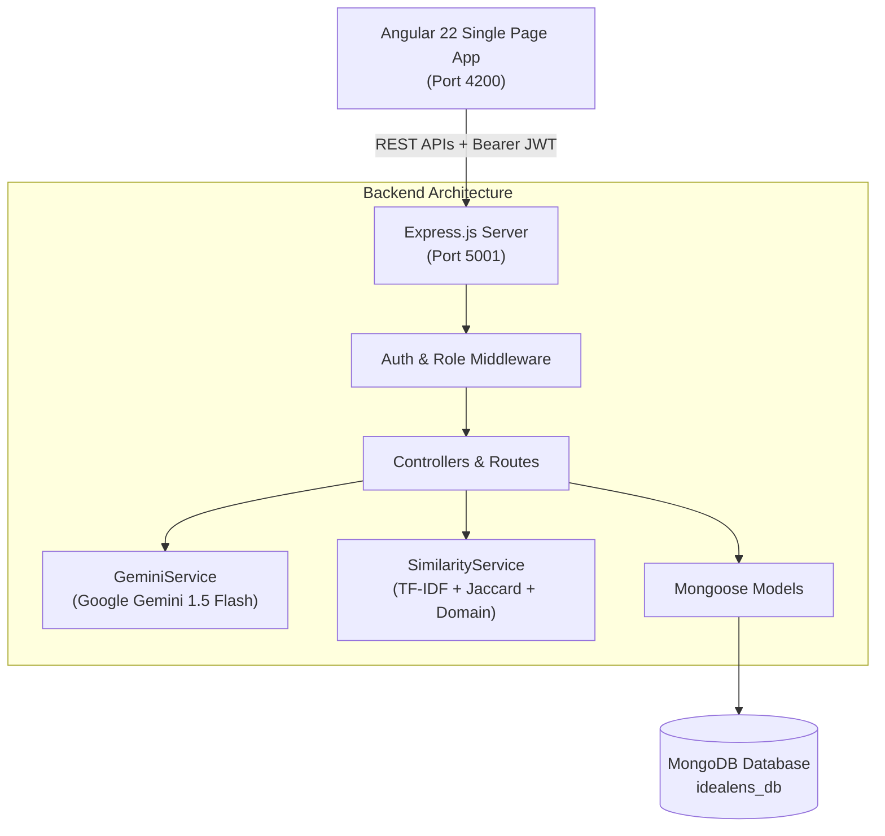

# IdeaLens — AI Project Idea & Novelty Analysis Platform

[](https://angular.dev/)
[](https://nodejs.org/)
[](https://angular.dev/)
[](https://www.mongodb.com/)
[](https://ai.google.dev/)

**IdeaLens** is a full-stack academic Application Lifecycle Management (ALM) and innovation platform where students propose software/engineering project ideas and receive AI-assisted evaluation, similarity analysis against existing project ideas in the institution's repository, structured innovation recommendations, project version control, requirements traceability, and faculty committee reviews.

---

## 1. Problem Statement & Objectives

### Problem Statement
In universities and engineering colleges:
1. **Duplicate or Redundant Projects:** Students frequently propose ideas that closely mirror past senior capstone projects without realizing existing implementations already exist.
2. **Delayed Feedback:** Manual faculty screening of hundreds of project proposals takes weeks, delaying development.
3. **Lack of Innovation Guidance:** Students often receive simple binary "approved/rejected" verdicts without actionable directions on how to differentiate their idea with cutting-edge architectures, scalability enhancements, or modern tech stacks.
4. **Poor Project Traceability:** Ideas are rarely connected systematically to engineering requirements, features, test cases, and defect tracking.

### Objectives
- Provide **instant, structured AI critique** across 13 engineering and architectural dimensions.
- Implement an **educational similarity & differentiation engine** using keyword extraction, technology Jaccard overlap, domain matching, and TF-IDF cosine similarity.
- Track **project version control** (v1, v2...) with side-by-side diffing of modified fields, added/removed technologies, and features.
- Connect **Requirements Traceability** (Project Idea ➔ Requirements ➔ Features ➔ Test Cases ➔ Issues).
- Facilitate an **academic faculty review workflow** (Draft ➔ Submitted ➔ Under Review ➔ Revision Requested ➔ Resubmitted ➔ Approved) with standardized 4-criteria rubrics.

> [!IMPORTANT]
> **Academic Novelty Notice:**
> IdeaLens provides *AI-assisted educational similarity and differentiation analysis* against projects stored within the institutional database. It does not constitute a formal patent search, intellectual property audit, or legal determination of novelty.

---

## 2. Technology Stack

### Frontend
- **Framework:** Angular 22 (Standalone Components, Signals, Computed Values)
- **Language:** TypeScript 5.9+
- **Styling:** Vanilla CSS3 Design System (Deep Slate Dark Mode, Glassmorphism, Micro-animations)
- **Routing:** Angular Router with functional `authGuard` and `roleGuard`
- **Forms:** Angular Reactive Forms with client-side validation
- **HTTP Client:** Angular `HttpClient` with functional Bearer token interceptor
- **Test Runner:** Vitest with Angular TestBed

### Backend
- **Runtime:** Node.js v26+
- **Framework:** Express.js REST API
- **Database ODM:** Mongoose 8+
- **Authentication:** JWT (JSON Web Tokens) with 7-day expiration
- **Password Security:** `bcryptjs` salted password hashing
- **Role-Based Authorization:** Middleware enforcing Student, Faculty, and Admin permissions
- **Logging:** Morgan HTTP logger
- **AI Integration:** Google Gemini 1.5 Flash via REST API with resilient deterministic heuristic fallback

### Database
- **Engine:** MongoDB (Local or MongoDB Atlas compatible)

---

## 3. Application Roles & Permissions

| Feature | Student | Faculty | Admin |
| :--- | :---: | :---: | :---: |
| Self-Registration & Login | Yes | Yes | Seeded / Superuser |
| Propose Project Ideas | Yes | — | Yes |
| Edit & Version Project Ideas | Yes (Owner) | — | Yes |
| Run Gemini AI Analysis | Yes | Yes | Yes |
| Run Similarity Engine | Yes | Yes | Yes |
| Manage Requirements Traceability | Yes (Owner) | Read-only | Yes |
| Submit Project for Faculty Review | Yes | — | Yes |
| Submit Official Faculty Reviews & Rubrics | — | Yes | Yes |
| Threaded Discussion Comments | Yes | Yes | Yes |
| User Administration & Deactivation | — | — | Yes |
| Live Aggregated Platform Metrics | Read-only | Read-only | Yes |

---

## 4. System Architecture



---

## 5. Database Schema & Collections

IdeaLens implements 13 normalized, indexed Mongoose models:

1. **`User`**: `name`, `email` (unique index), `password` (hashed with bcrypt), `role` (`student`, `faculty`, `admin`), `department`, `isActive`, timestamps.
2. **`Project`**: `title`, `problemStatement`, `proposedSolution`, `targetUsers`, `domain`, `technologies` (array), `keyFeatures` (array), `expectedOutcome`, `references`, `status` (`draft`, `submitted`, `under_review`, `revision_requested`, `resubmitted`, `approved`, `rejected`), `studentId` (ref: User), `currentVersion`, `lastAnalyzedAt`, text search indexes.
3. **`ProjectVersion`**: `projectId` (ref: Project), `versionNumber`, snapshot of title, problem, solution, tech, features, `changeSummary`, `createdBy` (ref: User), `analysisSnapshot`, `similaritySnapshot`.
4. **`Analysis`**: `projectId`, `versionNumber`, `projectSummary`, `problemAnalysis`, `targetUsersAnalysis`, `solutionAnalysis`, `technologiesAnalysis`, `strengths`, `weaknesses`, `potentialChallenges`, `innovationOpportunities`, `possibleImprovements` (5 categories), `suggestedAdditionalFeatures`, `potentialRealWorldApplications`, `potentialLimitations`, `overallScore`, `aiModelUsed`, `isFallback`.
5. **`SimilarityResult`**: `projectId`, `versionNumber`, `topMatches` array (similar project ref, similarity score, domain match, tech match score, text match score, common technologies, matching concepts, differences), `totalProjectsCompared`, `highestSimilarityPercentage`, `averageSimilarityPercentage`, `disclaimer`.
6. **`Requirement`**: `projectId`, `reqCode` (e.g. `REQ-001`), `title`, `description`, `priority` (`low`, `medium`, `high`, `critical`), `status` (`open`, `in_progress`, `completed`).
7. **`Feature`**: `projectId`, `requirementId` (ref: Requirement), `code` (e.g. `FEAT-001`), `title`, `description`, `complexity`, `status`.
8. **`TestCase`**: `projectId`, `featureId` (ref: Feature), `requirementId`, `code` (e.g. `TC-001`), `title`, `description`, `expectedResult`, `status` (`pending`, `passed`, `failed`).
9. **`Issue`**: `projectId`, `requirementId`, `featureId`, `testCaseId`, `code` (e.g. `ISS-001`), `title`, `description`, `severity` (`minor`, `major`, `critical`), `status`.
10. **`Review`**: `projectId`, `facultyId` (ref: User), `versionNumber`, `statusDecision`, `comments`, `criteriaRatings` (`problemClarity`, `innovationNovelty`, `technicalFeasibility`, `societalImpact`).
11. **`Comment`**: `projectId`, `authorId`, `authorRole`, `content`, timestamps.
12. **`Notification`**: `recipientId`, `senderId`, `projectId`, `type`, `title`, `message`, `isRead`, `link`.
13. **`Domain`**: `name`, `description`, `icon`, `isActive`.

---

## 6. REST API Documentation

### Authentication (`/api/auth`)
- `POST /api/auth/register` — Register student or faculty user
- `POST /api/auth/login` — Authenticate and receive JWT
- `GET /api/auth/me` — Get authenticated user profile

### Projects (`/api/projects`)
- `GET /api/projects` — Filter projects by domain, status, search, mine, sort
- `POST /api/projects` — Create new project idea (auto-generates Version 1)
- `GET /api/projects/:id` — Get single project details
- `PUT /api/projects/:id` — Update project idea (owner or admin)
- `DELETE /api/projects/:id` — Delete project idea (owner or admin)
- `POST /api/projects/:id/submit` — Submit project for faculty review
- `POST /api/projects/:id/analyze` — Run Gemini AI and similarity engines
- `GET /api/projects/:id/analysis` — Retrieve structured AI analysis
- `GET /api/projects/:id/similar` — Retrieve similarity matches
- `GET /api/projects/:id/versions` — Get version history
- `POST /api/projects/:id/versions` — Create new version (e.g. v2, v3)
- `GET /api/projects/:id/versions/compare?v1=1&v2=2` — Compare version diffs

### Similarity Explorer (`/api/similarity`)
- `GET /api/similarity/explore` — Search and filter projects by similarity parameters

### Faculty Reviews & Feedback (`/api/reviews`, `/api/projects/:id/reviews`)
- `GET /api/projects/:id/reviews` — Get review history and comments for project
- `POST /api/projects/:id/reviews` — Faculty submits decision and 4-criteria rubric
- `POST /api/projects/:id/comments` — Post discussion thread comment
- `GET /api/reviews` — Faculty workspace queue listing all submissions

### Traceability Matrix (`/api/projects/:projectId/...`)
- `GET /api/projects/:projectId/traceability-matrix` — Get full connected tree
- `GET /api/projects/:projectId/requirements` & `POST` — Requirements CRUD
- `GET /api/projects/:projectId/features` & `POST` — Features CRUD
- `GET /api/projects/:projectId/testcases` & `POST` — Test Cases CRUD
- `GET /api/projects/:projectId/issues` & `POST` — Issues CRUD

### Admin & Governance (`/api/admin`)
- `GET /api/admin/stats` — Live platform aggregated metrics and charts data
- `GET /api/admin/users` — List registered users with search and role filters
- `PATCH /api/admin/users/:id/toggle-status` — Activate/deactivate user account

---

## 7. AI & Similarity Methodology

### Gemini AI Integration
When a student clicks **Analyze Idea**:
1. The backend constructs a comprehensive prompt containing title, domain, problem statement, proposed solution, target users, technologies, key features, and expected deliverables.
2. The payload is sent to Gemini 1.5 Flash using `GEMINI_API_KEY` stored in `.env`.
3. Gemini outputs strict JSON matching the schema.
4. If no API key is set or the network is unavailable, an intelligent deterministic heuristic engine generates validated analysis with `isFallback: true` so the application never crashes.

### Similarity & Differentiation Engine
Projects are compared against all existing ideas in the MongoDB database using a multi-factor weighted algorithm:
- **Text Cosine Similarity (35% weight):** Term frequency vectors generated from normalized tokens (with English stop words removed) across title, problem, solution, and features.
- **Technology Jaccard Similarity (25% weight):** Overlap ratio between the two project technology sets, tracking common and unique technologies.
- **Proposed Solution Alignment (20% weight):** Cosine angle between proposed solution vectors.
- **Problem Statement Alignment (10% weight):** Cosine angle between problem descriptions.
- **Domain Matching (10% weight):** Exact match vs cross-domain applicability.
- **Concept & Differentiator Extraction:** Identifies overlapping concepts and distinct architectural differentiators.

---

## 8. Installation & Setup

### Prerequisites
- Node.js (v18 or higher; tested on v26)
- npm (v10 or higher)
- MongoDB running locally on port 27017 or a MongoDB Atlas URI

### 1. Clone & Configure Backend
```bash
cd backend
npm install
```

Copy `.env.example` to `.env`:
```bash
cp .env.example .env
```

Edit `backend/.env` with your settings:
```env
PORT=5001
NODE_ENV=development
MONGO_URI=mongodb://127.0.0.1:27017/idealens_db
JWT_SECRET=idealens_jwt_super_secure_secret_key_2026
JWT_EXPIRES_IN=7d
GEMINI_API_KEY=your_gemini_api_key_here
CLIENT_URL=http://localhost:4200
```
*(Note: If `GEMINI_API_KEY` is left blank, the application will automatically utilize the local heuristic analysis engine without error)*.

### 2. Seed Database
Run the seed script to populate the database with demo users, 18 realistic sample projects across domains, traceability items, reviews, and pre-computed similarity vectors:
```bash
npm run seed
```

### 3. Start Backend Server
```bash
npm run dev
# or: npm start
```
The backend server runs at `http://localhost:5001`.

### 4. Configure & Start Frontend
In a new terminal:
```bash
cd frontend
npm install
npm start
```
The Angular application starts at `http://localhost:4200`.

---

## 9. Demo User Accounts

Use these pre-seeded accounts for evaluation:

| Role | Email | Password | Description |
| :--- | :--- | :--- | :--- |
| **Student** | `student@idealens.edu` | `Password123!` | Can create, edit, version, analyze, and submit ideas |
| **Faculty** | `faculty@idealens.edu` | `Password123!` | Can evaluate submissions, write rubrics, and approve/reject ideas |
| **Admin** | `admin@idealens.edu` | `Password123!` | System administrator with full access to user management and KPIs |

*(Quick demo login buttons on `/login` allow one-click credential population).*

---

## 10. Testing

### Run Backend Integration Tests
```bash
cd backend
npm test
```
*Verifies Healthcheck, JWT authentication for all 3 roles, project CRUD, versioning, version comparison, Gemini analysis, similarity calculation, faculty review workflow, traceability creation, and admin statistics.*

### Run End-to-End Acceptance Test
```bash
cd backend
node tests/e2e-acceptance.js
```
*Executes the complete 18-step acceptance journey against the live server.*

### Run Frontend Tests
```bash
cd frontend
npm test -- --watch=false
```
*Runs Vitest component and service tests.*

### Build Frontend for Production
```bash
cd frontend
npm run build
```

---

## 11. Known Limitations & Future Enhancements

### Known Limitations
- The similarity engine compares ideas against projects existing in the local/institutional MongoDB repository; it does not crawl external patent offices (USPTO/WIPO) or commercial repositories.
- Gemini API calls are subject to standard Google AI rate limits if a high volume of simultaneous requests occurs.

### Future Enhancements
- Integration with Semantic Scholar and arXiv APIs for automated academic literature cross-referencing.
- Vector database integration (e.g., Pinecone or MongoDB Atlas Vector Search) using dense neural embeddings (`text-embedding-004`).
- Exportable formal Capstone Project Charter PDF report generation.
